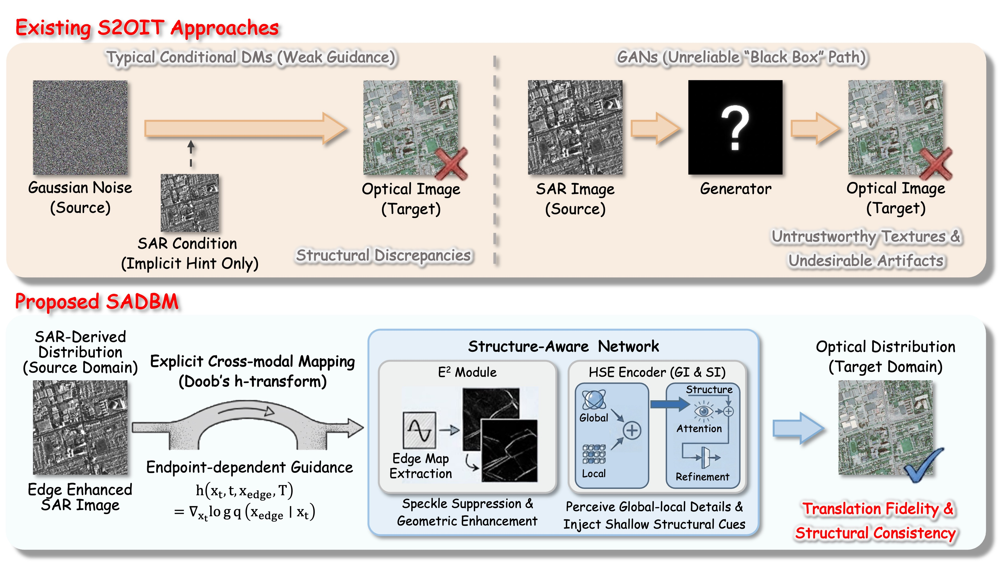
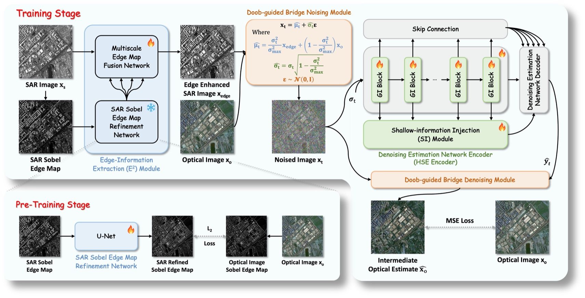
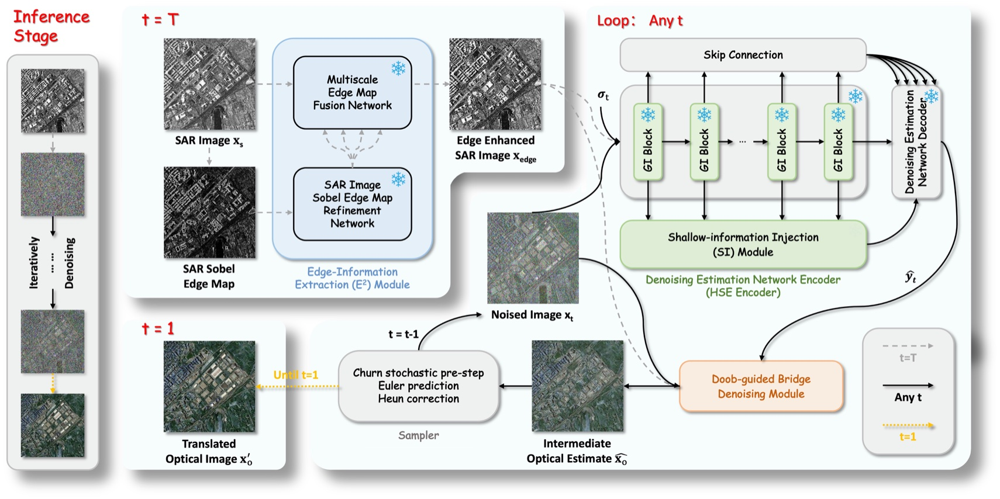
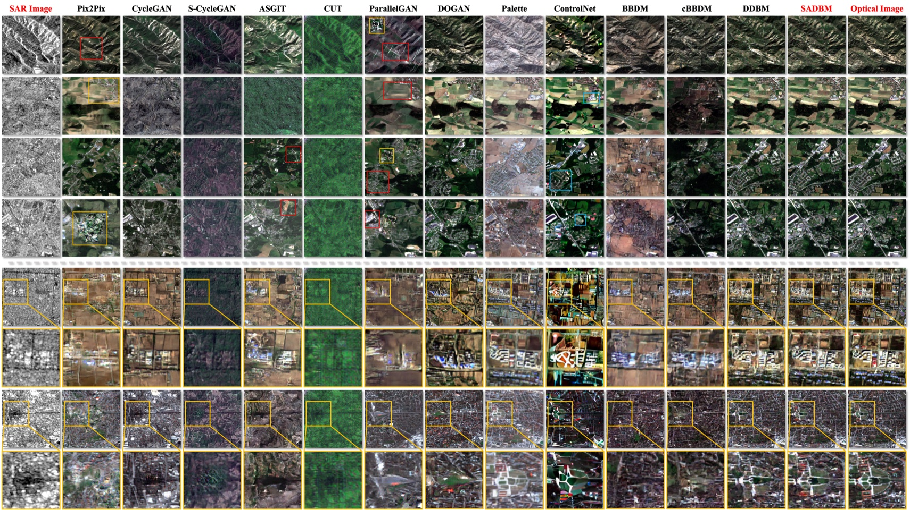
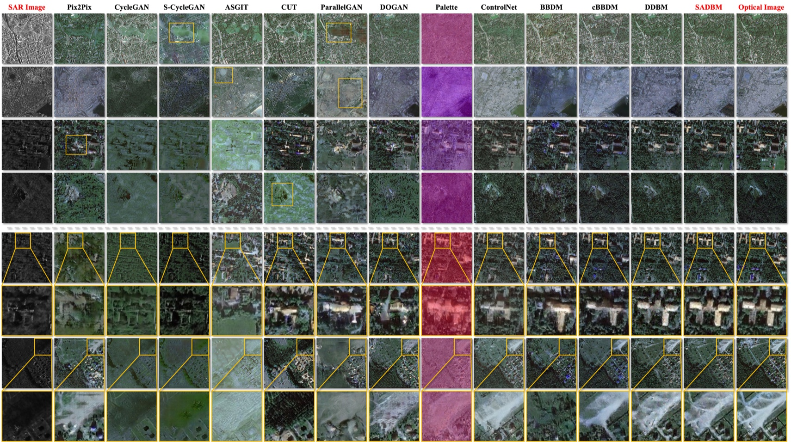

<h1 align="center">SADBM</h1>

<strong>Structure-Aware Diffusion Bridge Model for SAR-to-Optical Image Translation (S2OIT)</strong>

  
   
  <strong>Figure 1.</strong> Comparison of conditional diffusion models, GANs, and the proposed SADBM for SAR-to-optical translation. <a href="./fig01-framework-comparison.jpg?raw=true">Full resolution</a>

  <a href="#1-overview">Overview</a> ·
  <a href="#2-key-contributions">Method</a> ·
  <a href="#3-evaluation">Evaluation</a> ·
  <a href="#4-datasets">Datasets</a> ·
  <a href="#release-status">Release and usage</a>

## Overview 

SADBM translates a synthetic aperture radar (SAR) image into an optical image using a diffusion bridge that starts from an edge-enhanced version of the SAR input.

SAR can image the Earth day and night through cloud cover. Translating a SAR observation into optical imagery can make a scene easier to interpret, but speckle and differences between the two sensors can obscure field boundaries, roads, and buildings.

SADBM uses the geometry visible in the SAR observation to guide translation. It learns from paired SAR and optical images and requires **only a SAR image at inference**.

## Method 

  
   
  <strong>Figure 2.</strong> Training SADBM and pretraining its SAR edge-refinement network. <a href="./figures/fig02-training.jpg?raw=true">Full resolution</a>

### Structure-Aware Diffusion Bridge (Doob’s h-transform) 

We use **Doob’s h-transform** to construct a diffusion bridge between an edge-enhanced SAR image and its paired optical target. During inference, the reverse sampler starts at the SAR-derived endpoint and uses that endpoint to guide each denoising step.

  
   
  <strong>Figure 3.</strong> SADBM inference from an edge-enhanced SAR input with all network parameters frozen. <a href="./figures/fig03-inference.jpg?raw=true">Full resolution</a>

### Edge-information Extraction (E²) 

A lightweight U-Net learns to refine Sobel edges from SAR images using paired optical edge maps as supervision during pretraining. A learned weight blends the raw and refined SAR edge maps. A multi-scale residual network then fuses the blended edges with the SAR image to form the source endpoint.

### Hierarchical Structural Extraction (HSE) 

The **Global-structure Interaction (GI)** block combines patch-wise self-attention with dilated depthwise convolutions to capture long-range structure and local detail. The **Shallow-information Injection (SI)** module uses cross-attention to bring features from several encoder resolutions into the bottleneck, preserving fine geometric detail for the decoder.

## Evaluation 

### Image translation

We compare SADBM with 12 baselines on **SEN1-2 Scene** and **SAR2Opt**. Tables II and III of the manuscript report nine metrics.

| Dataset | SADBM on the seven paired metrics | Lowest FID and KID |
| --- | --- | --- |
| SEN1-2 Scene | **First on all seven** | Palette |
| SAR2Opt | **First on six**. cBBDM has the lowest LPIPS. | ASGIT |

| Comparison | Metrics (↑ higher is better, ↓ lower is better) |
| --- | --- |
| Each translation and its paired optical reference | PSNR ↑, SSIM ↑, CW-SSIM ↑, MHD ↓, RMSE ↓, LPIPS ↓, FSIM ↑ |
| The sets of translated and real optical images | FID ↓, KID ↓ |

<strong>Evaluation protocol</strong> · Image sizes, RGB PSNR, and boundary error

Paired metrics use the full image at its inference resolution. For SEN1-2 Scene, both images are evaluated at their native 256 × 256 pixels. For SAR2Opt, the full 600 × 600 optical reference is resized to 512 × 512 with bicubic interpolation to match the prediction.

RGB PSNR uses one mean squared error over all pixels and all three channels. The **modified Hausdorff distance (MHD)** measures boundary localization error in pixels between Canny edge maps extracted from the translation and its optical reference.

### Qualitative comparisons

  
   
  <strong>Figure 8.</strong> Qualitative comparison on SEN1-2 Scene, with enlarged regions below the full images. <a href="./figures/fig08-sen1-2-scene.jpg?raw=true">Full resolution</a>

  
   
  <strong>Figure 9.</strong> Qualitative comparison on SAR2Opt, with enlarged regions below the full images. <a href="./figures/fig09-sar2opt.jpg?raw=true">Full resolution</a>

### Downstream scene classification

On SEN1-2 Scene, we concatenate the SAR input with its translated optical image and compare classification against a SAR-only baseline. Tables IX–XII report per-class precision, overall accuracy (OA), average accuracy (AA, the mean per-class recall), and Cohen’s kappa for **ResNet-18**, **ResNet-50**, **DINO**, and **DINOv2**.

## Datasets 

### SEN1-2 Scene 

We curate **SEN1-2 Scene**, a six-class subset of SEN1-2, to evaluate both image translation and the value of translated optical imagery for scene classification.

The six scene categories are **Farmland, Forest, Mountain, Rural, Semi-Urban, and Urban**. The paired SAR and optical images come from the [SEN1-2 benchmark](https://isprs-annals.copernicus.org/articles/IV-1/141/2018/).

| Training pairs | Test pairs | Total pairs |
| ---: | ---: | ---: |
| 3,785 | 944 | **4,729** |

### SAR2Opt 

SAR2Opt contains co-registered SAR and optical images from multiple cities, with dense urban structures imaged at 1 m resolution. Dataset downloads, documentation, and citation information are available from the [official SAR2Opt repository](https://github.com/MarsZhaoYT/SAR2Opt-Heterogeneous-Dataset).

## Release and usage 

> [!NOTE]
> The SADBM source code, configurations, evaluation scripts, and pretrained models are planned for release upon paper acceptance.

Installation instructions, dependency versions, and commands for training, inference, and evaluation will be provided with the code release. Pretrained model download links and the corresponding configurations will also be documented here.

---

## 🔗 Our Related Projects

Explore three other SAR-to-optical image translation projects co-developed by members of the SADBM author team. They address optical priors, colour control, and cross-tile consistency. Click any figure to view it at full size.

### [DOGAN](https://github.com/Saturn-He/DOGAN)

  

DOGAN uses optical priors from a pretrained DINO model to guide GAN-based SAR-to-optical image translation. ([IEEE TGRS, 2025](https://doi.org/10.1109/TGRS.2025.3606979))

### [ColorS2O](https://github.com/Saturn-He/ColorS2O)

  

ColorS2O uses sparse colour anchors from an optical observation to control the colours of translated images.

### [XTile-S2O](https://github.com/Saturn-He/XTile-S2O)

  

XTile-S2O shares context across neighbouring tiles to improve spatial consistency in full-scene SAR-to-optical translation.
